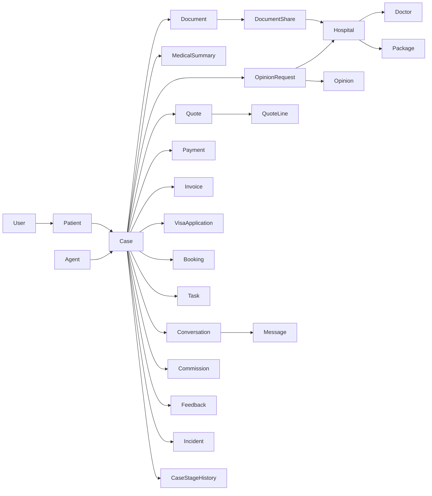

# Data model

> Generated from `packages/db/prisma/schema.prisma` by `pnpm --filter @medtravel/db docs:model`. Do not edit by hand: a test fails when this file is out of date.

The database holds **90 tables** and **55 enums** (PRD section 11). The central entity is the **Case**: one patient, one treatment episode, and everything else hangs off it.

## Overview

## Conventions

- **Keys** are UUIDs generated by the database (`gen_random_uuid()`). Country, Language and Currency use their ISO / BCP 47 code.
- **Business records** have `createdAt`, `updatedAt` and `deletedAt` (soft delete; hard delete only through retention jobs). Append-only tables (audit, outbox, stage history, exchange rates, sessions, medical summary versions) have no `updatedAt`.
- **Time** is `timestamptz` in UTC; dates without a time (birthday, passport expiry, validity) are `date`.
- **Money** is a `BigInt` (64-bit) in minor units next to an ISO currency code that is a foreign key to `Currency`; never a float. 64 bits because a 32-bit column overflows on ordinary prices in UZS, IQD and NGN. Where the amount is optional, a CHECK forbids an amount without its currency. Quotes and payments store the exchange rate they used (`Decimal(18,8)`).
- **Rates** (agreement %, commission %, tax %) are **basis points** (1250 = 12.5%), 0 to 10000.
- **Indexes**: every foreign key has one (except the currency codes on money columns, which have a handful of distinct values), plus the columns the screens filter or sort by: case stage, owner, agent, treatment, hospital, country, dates.
- **Search**: Hospital, Doctor, Treatment and Patient have a `searchVector` (`tsvector`, `simple` configuration, accents removed with `f_unaccent`) kept up to date by a trigger, with a GIN index. Patient search covers name, phone (as typed and digits only), passport number and email. Query with `"searchVector" @@ to_tsquery('simple', f_unaccent('asha:*'))`.
- **Enums** mirror `packages/contracts`; a test fails when they differ.
- **Personal data** (names, passport numbers, phones, medical text, messages) must never be logged. The passport number is searchable by design (the lead inbox and duplicate detection need it), so it sits in the search vector in clear; bank and payout details are `Json` columns the application is expected to encrypt (F-03 and later), the schema does not do it.
- **Access to patient data is through rows, not flags.** A hospital reaches a document only through a live `DocumentShare`, which can only exist under a `Consent` of the right type for the same patient and hospital; withdrawing the consent revokes its shares in the same transaction. Free medical text lives in `CaseIntake` and `MedicalSummary`, not on the `Case` row that lists and agents read. Staff-only notes are `CaseNote`, never `Message`.

## Human-readable numbers

`NumberSequence` hands out gap-free numbers inside the transaction that uses them: `CASE-YYYY-NNNNNN` (`Case.caseNo`), `Q-NNNNNN` (`Quote.quoteNo`), `INV/YY-YY/NNNNN` (`Invoice.invoiceNo`, the Indian financial year) and the credit-note number. The key says which counter, the period (year or financial year) restarts it.

## Rules the database enforces

Beyond foreign keys and unique constraints (added in the migration SQL because Prisma cannot express them):

- money is never negative; payments, refunds, payouts and credit notes are never zero
- rates are 0 to 10000 basis points; ratings are 1 to 5
- an e-mail is stored lower-case, so the unique index is case-insensitive in practice
- an amount always comes with its currency; an invoice is for a case or a hospital (a referral-fee invoice always for a hospital); a payment is for a case or an invoice; a file belongs to someone
- a document share needs a consent of type `share_medical_with_hospital` for the same patient and hospital, and is revoked when the consent is withdrawn
- an opinion request leaves draft only with a consent recorded
- one open opinion request per case and hospital, one current opinion per request, one accepted quote per case, one live commission per case and agent
- a retried event cannot create the same automatic task, or the same WhatsApp message, twice
- a file is 1 byte to 500 MB
- a visa application is for exactly one traveller (the patient or an attendant)
- one *current* medical summary per case; older versions stay
- the audit trail rejects updates and truncation (append-only); it has no foreign keys and its entity id is text, so it can describe ISO-keyed rows such as a country
- an exchange rate is positive and between two different currencies

## Master data and translations

Reference tables edited by admins (PRD 9.1). Countries, languages and currencies are keyed by their ISO or BCP 47 code. Every translatable master has a `<Name>Translation` table with one row per language; the English text lives on the master row.

| Entity | What it is | Belongs to | Has | Notes |
| --- | --- | --- | --- | --- |
| **Country** | ISO 3166 country (patients, agents, cities). |  | City (cities), CountryTranslation (translations), Patient (patients), Patient (patientsResident), Attendant (attendants), Case (cases), Agent (agents) |  |
| **CountryTranslation** | Country text in one language. The canonical (English) text lives on Country itself. | Country (country) |  | unique: countryCode + locale |
| **Language** | Interface and content language, by BCP 47 code (en, ar, ru, fr, ...). |  |  |  |
| **Currency** | ISO 4217 currency and how many minor-unit digits it has (2 for USD, 0 for JPY, 3 for KWD). |  | FxRate (fxRatesAsBase), FxRate (fxRatesAsQuote), Case (casesByBudgetCurrency), Admission (admissionsByCurrency), Doctor (doctorsByConsultFeeCurrency), Package (packagesByCurrency), Opinion (opinionsByCurrency), Quote (quotesByCurrency), Quote (quotesPricedFrom), QuoteLine (quoteLinesByCurrency), Invoice (invoicesByCurrency), CreditNote (creditNotesByCurrency), Payment (paymentsByCurrency), Refund (refundsByCurrency), StayRoom (stayRoomsByCurrency), Interpreter (interpretersByHourlyRateCurrency), Booking (bookingsByCurrency), Commission (commissionsByCurrency), Payout (payoutsByCurrency), PriceItemPrice (priceItemPrices), FxOverride (fxOverridesAsBase), FxOverride (fxOverridesAsQuote) |  |
| **FxRate** | Exchange rate: 1 base = rate quote, as of a moment. Quotes and payments copy the rate they used. |  |  | unique: baseCurrency + quoteCurrency + asOf |
| **Speciality** | Medical speciality (cardiology, orthopaedics). |  | Treatment (treatments), SpecialityTranslation (translations), MedicalSummary (medicalSummaries), Department (departments), Doctor (doctors) | soft delete |
| **SpecialityTranslation** | Speciality text in one language. The canonical (English) text lives on Speciality itself. | Speciality (speciality) |  | unique: specialityId + locale |
| **Treatment** | Procedure or treatment a patient can ask about (PRD 5.1). | Speciality (speciality) | TreatmentTranslation (translations), Case (cases), Package (packages), CommissionRule (commissionRules) | soft delete; full-text search |
| **TreatmentTranslation** | Treatment text in one language. The canonical (English) text lives on Treatment itself. | Treatment (treatment) |  | unique: treatmentId + locale |
| **City** | City where treatment or logistics happen. | Country (country) | CityTranslation (translations), StaffProfile (staffProfiles), Case (casesPreferringCity), Hospital (hospitals), HospitalBranch (hospitalBranches), Vendor (vendors), Stay (stays), Driver (drivers), Vehicle (vehicles), Interpreter (interpreters), Booking (bookings) | soft delete |
| **CityTranslation** | City text in one language. The canonical (English) text lives on City itself. | City (city) |  | unique: cityId + locale |
| **DocumentType** | Finer type of a stored file (MRI report, discharge summary); `kind` is its broad category. |  | DocumentTypeTranslation (translations), Document (documents) | soft delete |
| **DocumentTypeTranslation** | DocumentType text in one language. The canonical (English) text lives on DocumentType itself. | DocumentType (documentType) |  | unique: documentTypeId + locale |
| **LostReason** | Mandatory reason when a case is marked lost (PRD 6). |  | LostReasonTranslation (translations), Case (cases) | soft delete |
| **LostReasonTranslation** | LostReason text in one language. The canonical (English) text lives on LostReason itself. | LostReason (lostReason) |  | unique: lostReasonId + locale |

## Users and access

One `User` per login. What a user is linked to depends on the role: a Patient, an agent organisation, a hospital, or our own staff.

| Entity | What it is | Belongs to | Has | Notes |
| --- | --- | --- | --- | --- |
| **User** | One row per login. Linked to a Patient, Agent (AgentUser), HospitalStaff or StaffProfile by role. |  | Session (sessions), AuthChallenge (authChallenges), AuthChallenge (createdChallenges), BackupCode (backupCodes), StaffProfile (managedStaff), Team (managedTeams), PriceItemVersion (priceVersionsCreated), PartnerChangeRequest (changeRequestsSubmitted), PartnerChangeRequest (changeRequestsDecided), Accreditation (accreditationsVerified), MarginRule (marginRulesUpdated), DiscountThreshold (discountThresholdsUpdated), FxSetting (fxSettingsUpdated), FxOverride (fxOverridesCreated), StaffLeave (leaves), Case (ownedCases), Case (reviewedCases), CaseStageHistory (stageChanges), MedicalSummary (medicalSummaries), Document (uploadedDocuments), FileUpload (fileUploads), NotificationPreference (notificationPreferences), DocumentShare (documentShares), CaseNote (caseNotes), HospitalStaff (hospitalStaffs), OpinionRequest (sentOpinionRequests), Opinion (submittedOpinions), Quote (acceptedQuotes), Quote (createdQuotes), Refund (requestedRefunds), Refund (approvedRefunds), Task (assignedTasks), Task (createdTasks), Message (sentMessages), Notification (notifications), Incident (reportedIncidents), Incident (assignedIncidents), Incident (escalatedIncidents), StaffProfile (staffProfile), AgentUser (agentUser), Patient (patient), Attendant (attendant), Interpreter (interpreter) | soft delete |
| **Session** | A signed-in browser or device. Only a hash of the token is stored. One sign-in on one device. `tokenHash` is the hash of the current refresh token; it rotates on every refresh and the previous hash is kept so that a replayed (stolen) refresh token revokes the whole session. | User (user), Case (scopeCase, optional) |  |  |
| **AuthChallenge** | A one-time secret sent to a person: email verification, password reset, a sign-in code, an invitation or a magic link. Only hashes are stored; the token or code itself exists in the email and nowhere else. | User (user, optional), User (createdBy, optional) |  |  |
| **BackupCode** | A single-use recovery code for a user who lost their authenticator app. Stored hashed. | User (user) |  |  |
| **StaffProfile** | Our own staff (case managers, reviewers, ground coordinators, interpreters, finance): city, languages and round-robin state. | User (user), City (city, optional), User (manager, optional), Team (team, optional) |  | soft delete |
| **Team** | A group of staff under one manager. Joining a team sets the member's manager to the team's. | User (manager, optional) | StaffProfile (members) | soft delete |
| **StaffLeave** | Days a staff member is away; the assignment engine (C-02) skips them. | User (user) |  | soft delete |
| **AgentUser** | A login belonging to an agent organisation (sub-users). | User (user), Agent (agent) |  | soft delete |
| **HospitalStaff** | A hospital login: international desk staff or a doctor. | User (user), Hospital (hospital), HospitalBranch (branch, optional), Doctor (doctor, optional) |  | soft delete; unique: userId + hospitalId |

## Patients and consent

Personal and medical data. Hospitals and agents see only what a `Consent` row allows.

| Entity | What it is | Belongs to | Has | Notes |
| --- | --- | --- | --- | --- |
| **Patient** | A person seeking treatment. Has many Cases, Attendants and Documents. Personal data: never logged. | User (user, optional), Country (nationality, optional), Country (countryOfResidence, optional) | Attendant (attendants), Consent (consents), Case (cases), Document (documents), VisaApplication (visaApplications), Feedback (feedbacks) | soft delete; full-text search |
| **Attendant** | A family member travelling with the patient. | Patient (patient), User (user, optional), Country (nationality, optional) | CaseAttendant (caseAttendants), VisaApplication (visaApplications) | soft delete |
| **CaseAttendant** | Which attendants travel with the patient for a case. | Case (case), Attendant (attendant) |  | soft delete; unique: caseId + attendantId |
| **Consent** | What a patient agreed to, when, and whether they withdrew it. Hospital and agent sharing depend on these rows. | Patient (patient), Case (case, optional), Hospital (hospital, optional), Agent (agent, optional) | DocumentShare (documentShares), OpinionRequest (opinionRequests) | soft delete |

## Cases

The central entity: one patient, one treatment episode. Everything else hangs off the Case.

| Entity | What it is | Belongs to | Has | Notes |
| --- | --- | --- | --- | --- |
| **Case** | The central entity: one patient, one treatment episode. The stage changes only through CaseStageService (F-10). | Patient (patient), Treatment (treatment, optional), City (preferredCity, optional), Country (country, optional), Agent (agent, optional), User (owner, optional), User (reviewer, optional), Hospital (hospital, optional), LostReason (lostReason, optional) | Session (sessions), CaseAttendant (caseAttendants), Consent (consents), CaseStageHistory (stageHistory), MedicalSummary (medicalSummaries), Document (documents), CaseNote (caseNotes), Admission (admissions), OpinionRequest (opinionRequests), Quote (quotes), Invoice (invoices), InvoiceLine (invoiceLines), Payment (payments), VisaApplication (visaApplications), Booking (bookings), Commission (commissions), Task (tasks), Conversation (conversations), Notification (notifications), Incident (incidents), CaseIntake (caseIntake), Feedback (feedback) | soft delete; money in minor units |
| **CaseIntake** | What the patient told us about their condition. Medical text: kept off the Case row so an agent's or a list query never carries it by accident. | Case (case) |  | soft delete |
| **CaseNote** | A staff-only note on a case (Case 360 notes). Never shown to patients, hospitals or agents; messages to those people live in Message. | Case (case), User (author, optional) |  | soft delete |
| **CaseStageHistory** | Every stage change of a case, who made it and when. | Case (case), User (actor, optional) |  |  |
| **StageConfig** | What an admin changed about a stage: its target time, owner role and automatic tasks. A stage with no row uses the defaults in `packages/contracts` (`DEFAULT_STAGE_TARGET_MINUTES`, `STAGE_OWNER_ROLE`, `DEFAULT_AUTO_TASKS`). |  |  |  |
| **MedicalSummary** | The reviewer's structured summary. One current version per case; older versions are kept. | Case (case), User (reviewer, optional), Speciality (recommendedSpeciality, optional) | OpinionRequest (opinionRequests) | unique: caseId + version |
| **Document** | A file in the private bucket. Only metadata is here; downloads go through presigned URLs and are audited. | Patient (patient, optional), Case (case, optional), Agent (agent, optional), Hospital (hospital, optional), DocumentType (type, optional), User (uploadedBy, optional) | DocumentShare (shares), Admission (admissionsDischarged), Accreditation (accreditations), Hospital (hospitalAgreements), Quote (quotes), Invoice (invoices), VisaApplication (visaInvitations), MessageAttachment (messageAttachments) | soft delete |
| **FileUpload** | One browser upload of a file to the private bucket. The API creates it when it signs the start of the multipart upload and only signs later requests for keys it knows, for the same user, while it is open. | User (user) |  |  |
| **DocumentShare** | A patient-consented share of one document with one hospital. A hospital sees a document only through a live row here. | Document (document), Hospital (hospital), Consent (consent), User (sharedBy, optional) |  | soft delete; unique: documentId + hospitalId |

## Hospitals and doctors

Partner hospitals, their doctors and fixed-price packages.

| Entity | What it is | Belongs to | Has | Notes |
| --- | --- | --- | --- | --- |
| **Hospital** | A partner hospital. `agreementBp` is the referral-fee share in basis points (1250 = 12.5%). Bank details are stored encrypted by the application. | Document (agreementDocument, optional), City (city) | Consent (consents), Case (cases), Document (documents), DocumentShare (documentShares), Admission (admissions), HospitalBranch (branches), HospitalStaff (staff), Accreditation (accreditations), Department (departments), Doctor (doctors), HospitalTranslation (translations), Package (packages), OpinionRequest (opinionRequests), Invoice (invoices), StayHospitalDistance (stayDistances), CommissionRule (commissionRules), Conversation (conversations), Feedback (feedbacks), PartnerChangeRequest (changeRequests) | soft delete; full-text search |
| **HospitalTranslation** | Hospital text in one language. | Hospital (hospital) |  | unique: hospitalId + locale |
| **HospitalBranch** | A branch of a hospital group, managed from one login. | Hospital (hospital), City (city) | HospitalStaff (hospitalStaffs), Doctor (doctors) | soft delete |
| **Accreditation** | NABH, JCI and other accreditations, with the certificate and its expiry. | Hospital (hospital), User (verifiedBy, optional), Document (certificate, optional) |  | soft delete |
| **Department** | A speciality a hospital offers. | Hospital (hospital), Speciality (speciality) |  | soft delete; unique: hospitalId + specialityId |
| **Doctor** | A treating specialist at a hospital. | Hospital (hospital), HospitalBranch (branch, optional), Speciality (speciality) | Admission (admissions), HospitalStaff (hospitalStaffs), DoctorTranslation (translations), OpinionRequest (opinionRequests), Opinion (opinions), Feedback (feedbacks) | soft delete; full-text search; money in minor units |
| **DoctorTranslation** | Doctor text in one language. | Doctor (doctor) |  | unique: doctorId + locale |
| **Package** | A fixed-price package per procedure and room category; used by the cost estimator and the quote builder. | Hospital (hospital), Treatment (treatment) | PartnerChangeRequest (changeRequests), PackageTranslation (translations), Opinion (opinions) | soft delete; money in minor units |
| **PackageTranslation** | Package text in one language. | Package (package) |  | unique: packageId + locale |
| **Admission** | The treatment stay at a hospital: admission, surgery and discharge dates, and the estimate, running bill and final bill. Referral fees, commission and the bill-versus-estimate alert read these. | Case (case), Hospital (hospital), Doctor (doctor, optional), Document (dischargeSummary, optional) |  | soft delete; money in minor units; unique: caseId + hospitalId |

## Opinions and quotes

A case goes to hospitals as `OpinionRequest`s, they answer with an `Opinion`, and we offer the patient a `Quote`.

| Entity | What it is | Belongs to | Has | Notes |
| --- | --- | --- | --- | --- |
| **OpinionRequest** | A case sent to one hospital for an opinion. One per case and hospital. | Case (case), Hospital (hospital), Doctor (doctor, optional), MedicalSummary (summary, optional), Consent (consent, optional), User (sentBy, optional) | Opinion (opinions) | soft delete |
| **Opinion** | The hospital's answer to an OpinionRequest: plan, doctor, stay, estimate. | OpinionRequest (opinionRequest), Doctor (doctor, optional), Package (package, optional), User (submittedBy, optional) | Quote (quotes) | soft delete; money in minor units; unique: opinionRequestId + version |
| **Quote** | What we offer the patient. Stores the exchange rate it was priced with. | Case (case), Opinion (opinion, optional), User (acceptedBy, optional), User (createdBy, optional), Document (pdf, optional) | QuoteLine (lines), Payment (payments) | soft delete; money in minor units; unique: caseId + version |
| **QuoteLine** | One line of a quote; `costMinor` is our cost, kept for the profit report. | Quote (quote) |  | money in minor units |

## Pricing rules

What we charge (AD-05). A price change adds a `PriceItemVersion` and never edits an old one; a quote copies its price onto its lines, so later versions do not touch it. A manual `FxOverride` wins over the provider rate while it is in force.

| Entity | What it is | Belongs to | Has | Notes |
| --- | --- | --- | --- | --- |
| **PriceItem** | A thing we put a price on: Basic, Standard or Premium service, or an add-on (extra night, interpreter hour, SIM). The prices live in versions; changing a price adds a version and never edits an old one. |  | PriceItemVersion (versions) | soft delete |
| **PriceItemVersion** | One published set of prices for an item. The newest version is the current price list; older ones stay for history. | PriceItem (item), User (createdBy, optional) | PriceItemPrice (prices) | unique: itemId + version |
| **PriceItemPrice** | The price in one currency within a version. A currency with no row is converted from the INR price at the current rate. | PriceItemVersion (version) |  | money in minor units; unique: versionId + currency |
| **MarginRule** | Our margin on one kind of quote line, in basis points of cost. One row per component. | User (updatedBy, optional) |  |  |
| **DiscountThreshold** | The biggest discount (basis points of the quote) a role may give without someone above them approving it. | User (updatedBy, optional) |  |  |
| **FxSetting** | Exchange-rate settings; always one row with id `default`. A null provider means the environment's FX_PROVIDER. | User (updatedBy, optional) |  |  |
| **FxOverride** | A rate set by hand instead of the provider's: 1 base = rate quote, with a reason, until it expires or is removed. | User (createdBy, optional) |  |  |

## Partner approvals

What hospitals send us for review (AD-02). A `PartnerChangeRequest` holds the fields as submitted (`current`) and as proposed; approving applies `proposed` in the same transaction as the decision. Referral fee, agreement dates and accreditation checks live on `Hospital` and `Accreditation`.

| Entity | What it is | Belongs to | Has | Notes |
| --- | --- | --- | --- | --- |
| **PartnerChangeRequest** | A hospital's submission for review: the first onboarding, an edit to its profile, or a new package price. `current` is what the fields held when it was submitted and `proposed` what the hospital wants; approving applies `proposed` in one transaction. | Hospital (hospital), Package (package, optional), User (submittedBy, optional), User (decidedBy, optional) |  | soft delete |

## Money

Invoices, payments, refunds. Amounts are integer minor units next to a currency code.

| Entity | What it is | Belongs to | Has | Notes |
| --- | --- | --- | --- | --- |
| **Invoice** | GST invoice for our fees (to a patient) or a referral fee (to a hospital). Numbers look like INV/26-27/00001. | Case (case, optional), Hospital (hospital, optional), Document (pdf, optional) | InvoiceLine (lines), CreditNote (creditNotes), Payment (payments) | soft delete; money in minor units |
| **InvoiceLine** |  | Invoice (invoice), Case (case, optional) |  | money in minor units |
| **CreditNote** | Reduces an invoice. | Invoice (invoice) |  | soft delete; money in minor units |
| **Payment** | Money received. `pass_through` payments (hospital deposits) are a liability, not revenue. | Case (case, optional), Invoice (invoice, optional), Quote (quote, optional) | Refund (refunds) | soft delete; money in minor units; unique: gateway + gatewayRef |
| **Refund** | A request to give money back, with who approved it. | Payment (payment), User (requestedBy, optional), User (approvedBy, optional) |  | soft delete; money in minor units |

## Visa and logistics

The visa tracker, bookings, and the masters the logistics board uses (stays, vendors, drivers, vehicles, interpreters).

| Entity | What it is | Belongs to | Has | Notes |
| --- | --- | --- | --- | --- |
| **VisaApplication** | Visa tracker row for one traveller (the patient or an attendant) of a case. | Case (case), Patient (patient, optional), Attendant (attendant, optional), Document (invitationLetter, optional) |  | soft delete |
| **Booking** | A flight, stay, transfer, interpreter, SIM or other booking for a case (the logistics board reads these). | Case (case), Vendor (vendor, optional), Stay (stay, optional), Driver (driver, optional), Vehicle (vehicle, optional), Interpreter (interpreter, optional), City (city, optional) |  | soft delete; money in minor units |
| **Vendor** | A supplier of stays, transport, interpreters, SIMs or travel. | City (city, optional) | Stay (stays), Driver (drivers), Vehicle (vehicles), Booking (bookings) | soft delete |
| **Stay** | A partner guest house, hotel or service apartment. | Vendor (vendor, optional), City (city) | StayRoom (rooms), StayHospitalDistance (distances), Booking (bookings) | soft delete |
| **StayRoom** |  | Stay (stay) |  | money in minor units |
| **StayHospitalDistance** | How far a stay is from a hospital. | Stay (stay), Hospital (hospital) |  | unique: stayId + hospitalId |
| **Driver** |  | Vendor (vendor, optional), City (city, optional) | Vehicle (vehicles), Booking (bookings) | soft delete |
| **Vehicle** |  | Vendor (vendor, optional), Driver (driver, optional), City (city, optional) | Booking (bookings) | soft delete |
| **Interpreter** |  | User (user, optional), City (city, optional) | Booking (bookings) | soft delete; money in minor units |

## Agents and commission

Referral partners, how they are paid, and what they earned.

| Entity | What it is | Belongs to | Has | Notes |
| --- | --- | --- | --- | --- |
| **Agent** | A referral partner. KYC documents are Documents with this agent. Payout details are stored encrypted by the application. | Country (country), CommissionPlan (commissionPlan, optional) | AgentUser (agentUsers), Consent (consents), Case (cases), Document (documents), Commission (commissions), Payout (payouts), Conversation (conversations) | soft delete |
| **CommissionPlan** | How much of the hospital fee an agent earns. |  | Agent (agents), CommissionRule (rules) | soft delete |
| **CommissionRule** | Overrides the plan's default for one hospital and/or treatment. | CommissionPlan (plan), Hospital (hospital, optional), Treatment (treatment, optional) |  |  |
| **Commission** | What an agent earned on a case, once the hospital fee is received. | Case (case), Agent (agent), Payout (payout, optional) |  | soft delete; money in minor units |
| **Payout** | Money sent to an agent for approved commissions. | Agent (agent) | Commission (commissions) | soft delete; money in minor units |

## Work, messages and feedback

Tasks, conversations, notifications, ratings and incidents.

| Entity | What it is | Belongs to | Has | Notes |
| --- | --- | --- | --- | --- |
| **Task** | A to-do for a person, usually on a case. Some are created automatically on stage changes (`autoKey`). | Case (case, optional), User (assignee, optional), User (createdBy, optional) |  | soft delete |
| **Conversation** | A thread: with the patient, a hospital, an agent, or internal. | Case (case, optional), Hospital (hospital, optional), Agent (agent, optional) | Message (messages) | soft delete |
| **Message** | One message in a conversation. Message text can contain medical information: never logged. | Conversation (conversation), User (sender, optional) | MessageAttachment (attachments) | soft delete |
| **MessageAttachment** |  | Message (message), Document (document) |  | unique: messageId + documentId |
| **Notification** | A message the system sent to a user. In-app ones are what the bell shows. | User (user), Case (case, optional) |  | soft delete |
| **NotificationPreference** | Whether a person wants messages on a channel. No row means yes. In-app messages and security alerts cannot be switched off. | User (user) |  | unique: userId + channel |
| **Feedback** | A patient's ratings of a finished case; 1 to 5. | Case (case), Patient (patient), Hospital (hospital, optional), Doctor (doctor, optional) |  | soft delete |
| **Incident** | A complaint, complication or lost document, with escalation to a manager. | Case (case, optional), User (reportedBy, optional), User (assignee, optional), User (escalatedTo, optional) |  | soft delete |

## Platform

Audit trail, the event outbox and the counters behind human-readable numbers.

| Entity | What it is | Belongs to | Has | Notes |
| --- | --- | --- | --- | --- |
| **AuditEvent** | Who did or viewed what, when and from where. Append-only (a trigger rejects updates) and deliberately without foreign keys, so it outlives what it describes. |  |  |  |
| **OutboxEvent** | Domain events written in the same transaction as the change that caused them; the worker delivers them (notifications, audit, SLA timers). |  |  |  |
| **ProcessedWebhook** | Webhook events already handled (payment gateways, WhatsApp), so a replayed delivery is recognised and ignored. |  |  | unique: provider + eventId |
| **NumberSequence** | Gap-free counters for human-readable numbers: CASE-YYYY-NNNNNN, INV/YY-YY/NNNNN, Q-NNNNNN. Incremented inside the transaction that uses the number. |  |  |  |

## Enums

| Enum | Values |
| --- | --- |
| **Role** | `patient`, `attendant`, `agent`, `case_manager`, `ground_coordinator`, `interpreter`, `medical_reviewer`, `hospital_desk`, `doctor`, `finance`, `super_admin` |
| **CaseStage** | `enquiry`, `qualification`, `medical_review`, `hospital_opinions`, `quote_decision`, `booking_deposit`, `visa`, `travel_planning`, `arrival`, `treatment`, `discharge_return`, `follow_up`, `lost`, `on_hold`, `cancelled` |
| **CaseStatus** | `new`, `qualifying`, `in_medical_review`, `awaiting_opinions`, `quote_sent`, `won`, `visa_in_process`, `travel_booked`, `arrived`, `in_treatment`, `discharged`, `returned_home`, `follow_up`, `closed`, `lost`, `on_hold`, `cancelled` |
| **SessionKind** | `user`, `magic_link` |
| **AuthChallengeKind** | `email_verification`, `password_reset`, `login_code`, `invitation`, `magic_link` |
| **UserStatus** | `invited`, `active`, `suspended`, `deactivated` |
| **Gender** | `female`, `male`, `other`, `undisclosed` |
| **Urgency** | `routine`, `soon`, `urgent`, `emergency` |
| **CaseSource** | `website`, `whatsapp`, `phone`, `email`, `agent`, `referral`, `walk_in`, `other` |
| **DocumentKind** | `report`, `scan`, `prescription`, `passport`, `visa`, `invoice`, `bill`, `discharge`, `invitation_letter`, `photo`, `pickup_photo`, `kyc`, `agreement`, `other` |
| **DocumentVisibility** | `private`, `internal` |
| **FileUploadStatus** | `open`, `completed`, `aborted`, `expired` |
| **ScanStatus** | `pending`, `clean`, `infected`, `failed` |
| **ConsentType** | `data_processing`, `share_medical_with_hospital`, `share_stage_with_agent`, `marketing`, `public_review`, `whatsapp_contact` |
| **HospitalStatus** | `draft`, `pending_review`, `approved`, `published`, `unpublished`, `suspended` |
| **AccreditationBody** | `nabh`, `jci`, `nabl`, `iso`, `other` |
| **OpinionRequestStatus** | `draft`, `sent`, `viewed`, `accepted`, `declined`, `answered`, `expired`, `cancelled` |
| **QuoteStatus** | `draft`, `sent`, `viewed`, `accepted`, `rejected`, `expired`, `superseded` |
| **QuoteLineKind** | `hospital`, `stay`, `transfer`, `interpreter`, `service_fee`, `add_on`, `discount`, `other` |
| **PaymentType** | `deposit`, `service`, `pass_through`, `add_on`, `referral_fee` |
| **PaymentMethod** | `card`, `bank_wire`, `upi`, `payment_link`, `cash`, `other` |
| **PaymentStatus** | `pending`, `authorized`, `succeeded`, `failed`, `cancelled`, `partially_refunded`, `refunded`, `chargeback` |
| **InvoiceKind** | `service_fee`, `referral_fee` |
| **InvoiceStatus** | `draft`, `issued`, `partially_paid`, `paid`, `overdue`, `void` |
| **CreditNoteStatus** | `draft`, `issued`, `void` |
| **RefundStatus** | `requested`, `approved`, `rejected`, `processed`, `failed` |
| **VisaType** | `medical`, `medical_attendant`, `other` |
| **VisaStatus** | `not_started`, `documents_pending`, `invitation_requested`, `invitation_issued`, `applied`, `approved`, `rejected`, `expired` |
| **BookingType** | `flight`, `stay`, `transfer`, `interpreter`, `sim`, `other` |
| **BookingStatus** | `requested`, `confirmed`, `en_route`, `picked_up`, `in_progress`, `completed`, `cancelled` |
| **VendorKind** | `stay`, `transport`, `interpreter`, `sim`, `travel`, `other` |
| **StayType** | `guest_house`, `hotel`, `service_apartment` |
| **VehicleType** | `sedan`, `suv`, `van`, `wheelchair`, `ambulance` |
| **AgentStatus** | `applied`, `kyc_review`, `approved`, `suspended`, `rejected` |
| **AgentTier** | `silver`, `gold`, `platinum` |
| **CommissionStatus** | `earned`, `approved`, `paid`, `cancelled` |
| **PayoutStatus** | `requested`, `approved`, `processing`, `paid`, `failed`, `cancelled` |
| **PayoutMethod** | `international_wire`, `local_transfer` |
| **TaskStatus** | `open`, `in_progress`, `done`, `cancelled` |
| **TaskPriority** | `low`, `normal`, `high`, `urgent` |
| **MessageChannel** | `in_app`, `whatsapp`, `email`, `sms` |
| **MessageDirection** | `inbound`, `outbound` |
| **ConversationKind** | `patient`, `hospital`, `agent`, `internal` |
| **NotificationChannel** | `in_app`, `email`, `whatsapp`, `sms`, `push` |
| **NotificationStatus** | `queued`, `sent`, `delivered`, `read`, `failed` |
| **IncidentType** | `complaint`, `medical_complication`, `lost_documents`, `delay`, `other` |
| **IncidentSeverity** | `low`, `medium`, `high`, `critical` |
| **IncidentStatus** | `open`, `escalated`, `resolved`, `closed` |
| **AdmissionStatus** | `planned`, `admitted`, `discharged`, `cancelled` |
| **OutboxStatus** | `pending`, `processing`, `processed`, `failed` |
| **InterpreterEmployment** | `in_house`, `freelance` |
| **FxProvider** | `static`, `frankfurter`, `openexchangerates` |
| **PriceItemKind** | `service_package`, `add_on` |
| **ChangeRequestKind** | `hospital_onboarding`, `hospital_profile`, `package_price` |
| **ChangeRequestStatus** | `pending`, `approved`, `rejected`, `withdrawn` |
